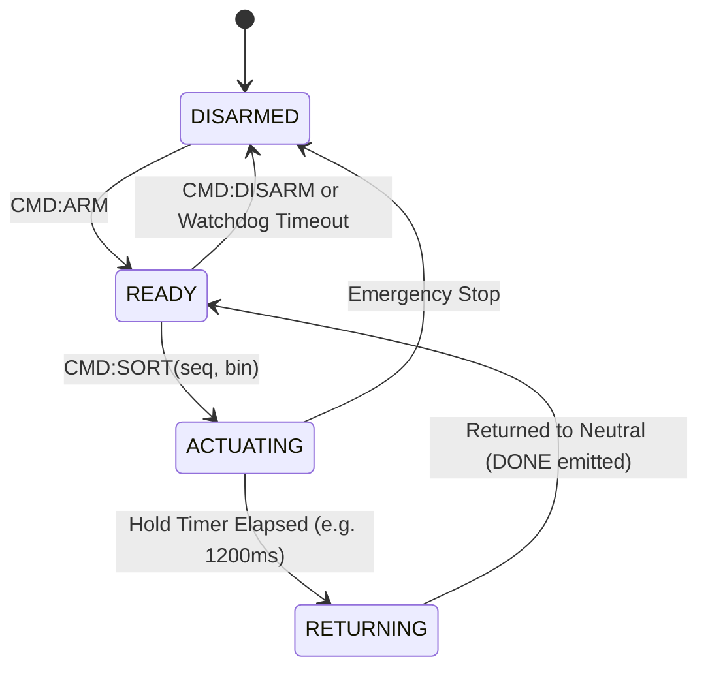
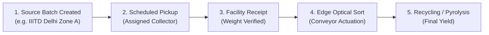

# Wasto Project Specification & Canonical Product Contract

**Version**: 1.0.0  
**Effective Date**: November 2026  
**Document Status**: Approved / Canonical Implementation Contract  

---

## 1. Executive Summary & Product Purpose

**Wasto** is an automated waste management and segregation platform designed to bridge source collection, optical edge classification, physical bin actuation, and facility-level recycling tracking. The system replaces fragmented manual sorting and unmonitored waste streams with an auditable, end-to-end digital lifecycle.

---

## 2. System Architecture & Topology

The Wasto system is organized into decoupled layers to ensure strict separation of concerns between web presentation, edge compute, embedded microcontrollers, and cloud storage:

```mermaid
flowchart TD
    subgraph UI ["User & Operator Layer"]
        Web["Wasto React Web App (Vite/Tailwind)"]
        Dashboard["Monitoring & Tracking Dashboard"]
    end

    subgraph Service ["Backend & Inference Layer"]
        API["FastAPI REST & SSE Service"]
        DB[(SQLite / Durable SQL Database)]
        MLService["Inference Engine (MobileNetV3)"]
        TaxonomyRouter["Operational Taxonomy & Policy Engine"]
    end

    subgraph EdgeHW ["Edge & Embedded Layer"]
        EdgeRuntime["Python Edge Worker (OpenCV Frame Ingestion)"]
        SerialBridge["Non-blocking Async Serial Bridge"]
        Arduino["Arduino Uno Microcontroller (Firmware)"]
        Servos["Mechanical Flaps & Ultrasonic Telemetry"]
    end

    Web -->|HTTP / JSON| API
    Dashboard -->|HTTP / JSON / SSE| API
    API --> DB
    API --> MLService
    MLService --> TaxonomyRouter

    EdgeRuntime -->|Frame Ingest| MLService
    EdgeRuntime -->|Serial Commands (Protocol v1.0)| SerialBridge
    SerialBridge <-->|UART 9600 Baud| Arduino
    Arduino --> Servos
```

### 2.1 Monorepo Structure
```
Wasto/
├── apps/
│   └── web/                 # React 18, TypeScript, Tailwind CSS, Vite frontend
├── services/
│   └── api/                 # FastAPI backend, routing, database persistence, inference API
├── edge/                    # OpenCV camera runtime, frame buffer, serial bridge
├── firmware/
│   └── wasto_sorter/        # Compilable Arduino C++ sketch for servo & sensor control
├── ml/                      # Training scripts, evaluation, export pipelines, model card
├── shared/                  # Common taxonomy schemas, protocol definitions, constants
├── docs/                    # Claim matrix, project spec, hardware guides, release evidence
├── tests/                   # Pytest unit, integration, ML parity, and serial tests
├── README.md                # Synchronized project documentation
└── netlify.toml             # Frontend deployment configuration
```

---

## 3. Operational Modes

To ensure deterministic testing, local development, and reproducible hardware verification, Wasto operates in three distinct, mutually exclusive modes. Every telemetry event, prediction record, and dashboard visual explicitly records and displays its active operational mode:

| Operational Mode | Model Engine | Hardware Interface | Primary Use Case |
| :--- | :--- | :--- | :--- |
| **`real_model_simulated_hw`** | Real MobileNetV3 weights (`model.h5` / ONNX) | `SimulatorAdapter` (software virtual Arduino loopback) | Default development and cloud-hosted demonstration mode. Validates full ML and business logic without physical devices. |
| **`real_model_connected_hw`** | Real MobileNetV3 weights (`model.h5` / ONNX) | `SerialArduinoAdapter` (physical USB UART to Arduino Uno) | Real-world physical sorting cells on edge industrial workstations. |
| **`deterministic_fixtures`** | Labeled static test vectors (no model overhead) | `SimulatorAdapter` (mock loopback) | Automated CI/CD pipelines, unit regression suites, and offline UI testing. |

---

## 4. Taxonomy & Routing Policy

### 4.1 The Material vs. Routing Separation Principle
Legacy implementations erroneously conflated material composition with physical routing (e.g. treating everything other than plastic as biodegradable). In Wasto 1.0.0, **Material Classification** is strictly decoupled from **Routing Action**:

1. **Material Label**: The objective composition identified by the vision classifier.
2. **Routing Category**: The operational destination assigned by policy rules based on cleanliness, recyclability, and local municipal facility capabilities.

### 4.2 Material Classes (9-Class Vision Output)
The classifier is trained to detect nine fine-grained material categories:
1. `Aluminium`
2. `Carton`
3. `Glass`
4. `Organic Waste`
5. `Other Plastics`
6. `Paper and Cardboard`
7. `Plastic`
8. `Textiles`
9. `Wood`

### 4.3 Operational Bins & Abstention Rules
Wasto maps material predictions into three operational physical bins plus one safety abstention category:

| Operational Bin | Allowed Materials | Sorting Flap Position | Policy Rationale |
| :--- | :--- | :--- | :--- |
| **`Organic`** | `Organic Waste` | Flap Angle: +45° (Chute 1) | Compostable biogenic matter. Never route glass, plastic, or metals here. |
| **`Recyclable`** | `Aluminium`, `Carton`, `Glass`, `Paper and Cardboard`, `Plastic` | Flap Angle: 0° / Neutral (Chute 2) | Clean dry recyclables suitable for optical recovery and mechanical processing. |
| **`Residual`** | `Other Plastics`, `Textiles`, `Wood` | Flap Angle: -45° (Chute 3) | Non-recyclable, mixed polymers, composites, or combustible fraction. |
| **`Unknown / Manual Review`** | Low confidence (< 0.60), ambiguous top-2 margin (< 0.15), or corrupted images | Hold / Disarm (No actuation) | Failsafe state. Never actuates sorting flaps automatically on uncertain predictions. |

> [!IMPORTANT]
> **Zero False Biodegradability Rule**: Glass, metal, and complex synthetics are NEVER classified as biodegradable. Under no circumstance shall non-plastic items default to `Organic`.

---

## 5. Model Input/Output Contract

### 5.1 Input Preprocessing Specification
- **Input Channels**: 3-channel RGB (OpenCV BGR feeds MUST be explicitly converted to RGB).
- **Target Spatial Dimensions**: `256 x 256` pixels (matches `model.h5` architecture contract).
- **Normalization**: Pixel values scaled to `[-1.0, 1.0]` using standard MobileNetV3 preprocessing:
  $$\hat{x} = \frac{x - 127.5}{127.5}$$
  *(Double normalization by user code is strictly prohibited when using built-in Keras preprocessing).*

### 5.2 Prediction Output Schema
```json
{
  "prediction_id": "pred_01HGBX5A8...",
  "timestamp": "2026-11-10T16:40:00Z",
  "material_label": "Glass",
  "routing_category": "Recyclable",
  "confidence": 0.942,
  "scores": {
    "Aluminium": 0.012,
    "Carton": 0.005,
    "Glass": 0.942,
    "Organic Waste": 0.001,
    "Other Plastics": 0.008,
    "Paper and Cardboard": 0.004,
    "Plastic": 0.015,
    "Textiles": 0.003,
    "Wood": 0.010
  },
  "is_uncertain": false,
  "routing_policy_version": "v1.0",
  "inference_latency_ms": 28.4
}
```

---

## 6. Edge Hardware & Serial Bridge Protocol (v1.0)

### 6.1 Framing & Syntax
Communication between the Python Edge Runtime and the Arduino Uno occurs over 9600 Baud UART using ASCII newline-terminated frames:
`CMD:<seq>:<action>:<target_bin>:<param>\n`

- `CMD`: Command marker.
- `<seq>`: Monotonically increasing sequence integer (`1`, `2`, `3`...).
- `<action>`: `SORT`, `PING`, `ARM`, `DISARM`, `STATUS`.
- `<target_bin>`: `ORGANIC`, `RECYCLABLE`, `RESIDUAL`, or `NONE`.
- `<param>`: Hold duration in milliseconds (e.g. `1200`).

### 6.2 Response Messages from Firmware
- `ACK:<seq>`: Microcontroller successfully parsed and validated the command.
- `DONE:<seq>`: Servo actuation completed; mechanical flap returned to neutral rest state.
- `BUSY:<seq>`: Command rejected because previous actuation cycle is still in progress.
- `ERR:<seq>:<code_str>`: Malformed frame, invalid bin, or watchdog timeout.
- `PONG`: Heartbeat reply.
- `TELEM:<distance_cm>:<fill_pct>`: Ultrasonic fill level reading.

### 6.3 State Machine Diagram


---

## 7. Source-to-Recycling Tracking Contract

Wasto fulfills the end-to-end lifecycle tracking requirement through an immutable event log spanning five lifecycle stages:



### 7.1 Lifecycle Entities
1. **`WasteBatch`**: Identifier, origin organization, scheduled pickup date, estimated volume, material category.
2. **`TrackingEvent`**: Timestamped immutable record recording state transition, actor ID, physical GPS or location text, notes, and optional linked `prediction_id` or `sorting_event_id`.
3. **`BinTelemetry`**: Periodic sensor readings measuring fill levels and load cell weights.

---

## 8. Deployment Topology & Boundaries

1. **Frontend (`apps/web`)**: Hosted statically on Netlify (`https://wasto.netlify.app/`). Connects via environment variable `VITE_API_BASE_URL` to the backend. Features client-side fallback to deterministic demo fixtures if API is unreachable.
2. **Backend API (`services/api`)**: Python FastAPI application deployed on a standard cloud container (Fly.io, Railway, Render, or local edge server). Exposes OpenAPI endpoints and manages SQLite/PostgreSQL storage.
3. **Edge Worker (`edge/`)**: Runs locally on the physical sorting workstation connected to the webcam and Arduino Uno via USB.

---

## 9. Evidence & Verification Rules

1. **Zero Fabrication Policy**: No physical actuation or hardware performance claims may be stated as "completed" without real timestamped hardware execution logs or test evidence.
2. **Simulation Transparency**: When running without connected hardware, all logs, telemetry, and UI badges MUST explicitly indicate `SIMULATED`.
3. **Confidence Disclosure**: Softmax distribution values are labeled **Confidence Scores**, never conflated with overall system accuracy.
